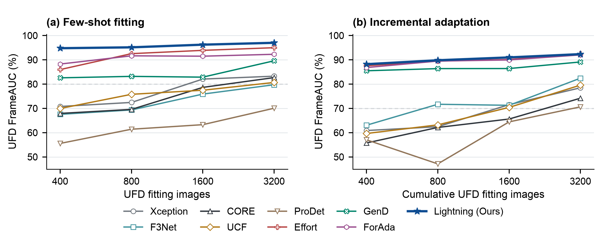
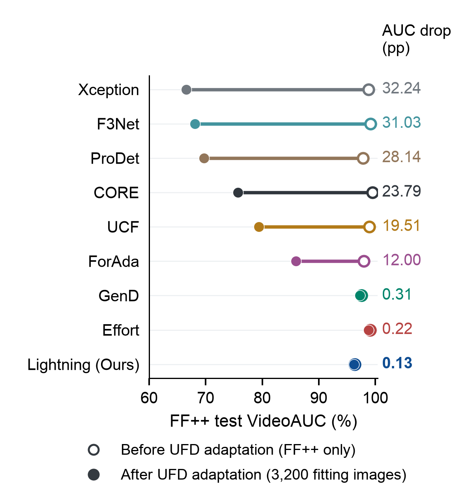

# Lightning_AGI_Detector

**Lightning detects general AI-generated images after fitting on FaceForensics++ (FF++) alone.** We evaluate the same face-forgery checkpoint on OpenFake and UniversalFakeDetect without target-domain adaptation.

- **OpenFake (46 generators).** Lightning reaches **79.90% generator-macro AUC** and **76.27% overall AUC**, ahead of ForAda, the strongest evaluated gradient-trained baseline, by **17.28** and **14.03 AUC points**, respectively. Its 10th-percentile generator AUC is **63.07%**, an **8.48-point** gain over ForAda.
- **UniversalFakeDetect (UFD, 21 subgroups).** Lightning reaches **92.22% macro AUC**, **7.04 AUC points** ahead of GenD, the strongest evaluated gradient-trained baseline on this metric. On the diffusion subgroups, Lightning leads the best gradient-trained baseline by **6.98 AUC points** in macro AUC.

## Method Overview

Lightning extracts global and patch-mean features from intermediate blocks of a frozen, pretrained vision backbone. It centers and scales these features using statistics from real source images, then compresses them spectrally for gradient-free Ridge fitting.

With a shared, fixed feature mapping, workers can accumulate sufficient statistics on disjoint data partitions. Summing these statistics and solving centrally gives the same Ridge solution as fitting on the pooled data with the same regularization strength.

```text
Input image
└── Frozen vision backbone
    └── Features from selected blocks
        ├── Global readout
        │   └── Block-wise spectral projection and concatenation → Ridge score
        └── Patch-mean readout
            └── Block-wise spectral projection and concatenation → Ridge score

Final detection score = mean of the two raw scores
```


## Environment

Run the commands from the repository root with [uv](https://docs.astral.sh/uv/) installed.

1. **Install dependencies.**

   ```bash
   uv sync --locked
   ```

2. **Create `.env`.**

   ```bash
   test -f .env || cp .env.example .env
   ```

3. **Set `FFPP_ROOT` in `.env` to your local FaceForensics++ directory.**

   ```dotenv
   FFPP_ROOT="${HOME}/datasets/DeepfakeDataset/FaceForensics++"
   ```

   The [bundled manifests](configs/manifests/) expect extracted frames under `FFPP_ROOT`, such as `original_sequences/youtube/c23/frames/001/000.png`.

Lightning downloads the default `openai/clip-vit-large-patch14` backbone weights from Hugging Face if they are missing from the local cache. See [`detectors/lightning/config.py`](detectors/lightning/config.py) for the backbone setting.

## Training

Fit Lightning on the FaceForensics++ training split and score it on the validation split. The bundled manifests sample 8 frames per training video and 32 per validation or test video.

**Single process**

```bash
uv run python engine.py fit --model lightning \
  --train-input ffpp_train \
  --validation-input ffpp_val
```

**Multi-GPU on one host**

```bash
uv run torchrun --standalone --nproc-per-node=gpu engine.py fit --model lightning \
  --train-input ffpp_train \
  --validation-input ffpp_val
```

The engine defaults to `--device auto`, which selects an available PyTorch accelerator and falls back to CPU. Use `--device cpu` to force CPU or `--device cuda` to require CUDA. `torchrun --nproc-per-node=gpu` launches one process per visible CUDA GPU and the engine assigns devices by local rank. Use `CUDA_VISIBLE_DEVICES` to limit which GPUs are visible.

Each process reads a separate data shard with its own `batch_size`. Rank 0 combines the statistics, solves the Ridge readout, and saves `fit/model.pth` in the run directory printed by `fit`. To continue fitting on new images, pass this checkpoint to `fit` with `--checkpoint` and select the new training input with `--train-input`. Lightning reuses the saved feature mapping and updates the Ridge statistics.

## Evaluation

Set `CHECKPOINT` to `fit/model.pth` in the run directory printed by `fit`.

```bash
CHECKPOINT="outputs/your-fit-run/fit/model.pth"
```

**Single process**

```bash
uv run python engine.py evaluate --model lightning \
  --checkpoint "$CHECKPOINT" \
  --test-inputs ffpp_test
```

**Multi-GPU on one host**

```bash
uv run torchrun --standalone --nproc-per-node=gpu engine.py evaluate --model lightning \
  --checkpoint "$CHECKPOINT" \
  --test-inputs ffpp_test
```

Multi-GPU evaluation combines predictions from all ranks before computing metrics, including video-level scores. The run directory contains `summary.csv` and a `metrics.json` and `predictions.jsonl` for each input. `--test-inputs` accepts one or more input names from the [shared config](configs/config.yaml).

## Benchmark Results

All detectors were fitted on FaceForensics++ (FF++) and evaluated without target-domain adaptation. Values are FrameAUC (%). Bold marks the best result in each row. ProDet† uses the authors' released FF++ checkpoint.

### OpenFake

All 46 generators are evaluated against the same 75,525 real images.

| Generator | Xception | F3Net | CORE | UCF | ProDet† | Effort | GenD | ForAda | Lightning |
| --- | ---: | ---: | ---: | ---: | ---: | ---: | ---: | ---: | ---: |
| aurora-20-1-25 | 61.42 | 57.77 | 57.17 | 48.77 | 63.47 | 47.39 | 51.14 | 59.50 | **79.44** |
| chroma | 62.08 | 68.34 | 61.89 | 64.97 | 49.92 | 49.72 | 51.61 | 68.37 | **90.86** |
| dalle-3 | 49.75 | 51.94 | 52.37 | 53.60 | 38.39 | 35.39 | **71.40** | 54.64 | 70.79 |
| ernie-image | 52.06 | 58.24 | 47.65 | 57.75 | 41.45 | 41.75 | 57.14 | 68.24 | **77.07** |
| ernie-image-turbo | 46.68 | 54.09 | 46.56 | 56.90 | 29.13 | 36.07 | 58.12 | **74.31** | 71.48 |
| flux-1.1-pro | 54.21 | 64.39 | 55.74 | 58.12 | 49.55 | 40.44 | 30.71 | 55.98 | **81.31** |
| flux-amateursnapshotphotos | 64.34 | 65.97 | 62.30 | 62.20 | 49.54 | 39.13 | 31.12 | 59.86 | **85.05** |
| flux-mvc5000 | 47.14 | 53.12 | 47.65 | 50.40 | 46.96 | 28.60 | 29.81 | 47.88 | **63.76** |
| flux-realism | 61.72 | 65.52 | 59.74 | 56.26 | 50.16 | 34.56 | 31.36 | 54.38 | **86.16** |
| flux.1-dev | 64.44 | 70.08 | 65.80 | 61.74 | 52.58 | 34.15 | 33.58 | 54.54 | **88.86** |
| flux.1-schnell | 62.21 | 66.74 | 60.34 | 67.70 | 51.74 | 47.83 | 42.47 | 62.62 | **90.46** |
| flux.2-klein-9b | 39.18 | **53.72** | 44.68 | **53.72** | 26.35 | 33.79 | 30.47 | 50.82 | 50.49 |
| frames-23-1-25 | 59.56 | 59.81 | 57.16 | 53.62 | 54.18 | 37.75 | 45.72 | 61.33 | **84.33** |
| gpt-image-1 | 48.73 | 60.76 | 54.12 | 50.06 | 33.94 | 38.20 | 44.65 | 55.62 | **74.92** |
| gpt-image-1.5 | 37.54 | 44.45 | 32.82 | 43.28 | 35.18 | 40.28 | 57.26 | **72.73** | 52.68 |
| gpt-image-2 | 37.74 | 57.56 | 35.98 | 52.23 | 31.84 | 44.07 | 58.64 | **71.83** | 61.62 |
| grok-2-image-1212 | 54.64 | 56.36 | 60.32 | 42.88 | 55.84 | 34.45 | 37.91 | 57.37 | **61.00** |
| halfmoon-4-4-25 | 66.77 | 65.99 | 68.84 | 60.43 | 59.79 | 36.20 | 54.31 | 60.64 | **85.60** |
| hidream-i1-full | 64.26 | 67.84 | 62.16 | 67.17 | 49.75 | 37.69 | 38.27 | 56.79 | **87.30** |
| ideogram-2.0 | 56.24 | 58.21 | 54.53 | 50.59 | 47.27 | 35.95 | 50.89 | 63.00 | **85.47** |
| ideogram-3.0 | 53.74 | 59.03 | 54.41 | 51.97 | 42.85 | 36.91 | 35.25 | 56.16 | **86.73** |
| illustrious | 49.64 | 59.00 | 44.34 | 59.00 | 26.80 | 39.08 | 60.06 | 78.49 | **81.86** |
| imagen-3.0-002 | 54.30 | 59.90 | 53.88 | 60.16 | 37.51 | 34.80 | 31.43 | 55.78 | **73.70** |
| imagen-4.0 | 59.72 | 65.55 | 58.60 | 66.58 | 42.73 | 36.96 | 33.21 | 57.01 | **80.55** |
| lumina-17-2-25 | 78.82 | 77.73 | 72.44 | 81.10 | 59.60 | 33.79 | 62.63 | 64.82 | **86.90** |
| midjourney-6 | 49.75 | 55.02 | 48.34 | 49.25 | 45.03 | 29.27 | 45.92 | 51.19 | **76.80** |
| midjourney-7 | 66.50 | 62.17 | 62.21 | 52.92 | 58.49 | 34.92 | 51.96 | 61.18 | **87.22** |
| mystic | 62.81 | 66.06 | 60.49 | 62.42 | 44.78 | 45.55 | 43.64 | 59.84 | **86.61** |
| nano-banana-pro | 43.30 | 54.24 | 45.82 | 35.81 | 38.54 | 51.49 | 77.09 | 73.09 | **83.44** |
| recraft-v2 | 62.29 | 62.78 | 58.84 | 56.35 | 47.21 | 29.83 | 42.52 | 56.28 | **75.50** |
| recraft-v3 | 58.53 | 56.85 | 58.21 | 44.76 | 54.65 | 34.89 | 41.25 | 56.86 | **84.15** |
| sd-1.5 | 36.43 | 57.16 | 43.78 | 57.28 | 43.88 | 55.37 | 69.45 | 77.05 | **82.21** |
| sd-1.5-dreamshaper | 34.90 | 45.95 | 33.74 | 30.18 | 31.94 | 42.64 | 70.05 | 71.64 | **85.66** |
| sd-1.5-epicdream | 43.67 | 45.69 | 49.88 | 38.77 | 41.53 | 42.64 | 47.72 | 56.97 | **87.37** |
| sd-2.1 | 48.01 | 61.01 | 55.49 | 60.90 | 44.56 | 68.30 | 77.44 | 80.61 | **91.89** |
| sd-3.5 | 59.15 | 63.80 | 56.18 | 63.91 | 44.66 | 39.42 | 42.68 | 61.92 | **87.93** |
| sdxl | 51.26 | 59.12 | 55.49 | 54.00 | 48.24 | 47.37 | 59.46 | 69.32 | **92.93** |
| sdxl-epic-realism | 48.17 | 56.50 | 57.29 | 51.78 | 38.25 | 39.72 | 47.82 | 56.39 | **80.77** |
| sdxl-juggernaut | 57.05 | 64.33 | 56.80 | 65.73 | 37.29 | 38.65 | 41.75 | 57.53 | **80.16** |
| sdxl-realvis-v5 | 36.65 | 45.98 | 44.29 | 41.06 | 31.31 | 38.23 | 44.42 | 59.03 | **83.03** |
| sdxl-touchofrealism | 53.46 | 59.17 | 58.80 | 46.71 | 47.22 | 40.56 | 50.39 | 61.77 | **91.39** |
| seedream-v5.0 | 41.85 | 43.12 | 39.68 | 34.90 | 29.34 | 39.29 | 69.79 | **79.24** | 70.56 |
| sora-2 | 40.06 | 47.55 | 39.85 | 35.59 | 35.51 | 46.08 | 60.87 | **65.48** | 62.38 |
| veo-3 | 53.34 | 58.68 | 49.79 | 50.46 | 47.42 | 46.62 | 65.20 | 72.62 | **84.68** |
| wan-video-2.5 | 48.20 | 55.78 | 44.02 | 44.43 | 42.47 | 40.70 | 66.11 | 71.95 | **82.65** |
| z-image-turbo | 51.25 | 58.00 | 50.10 | 54.37 | 43.04 | 31.98 | 45.42 | 57.64 | **79.50** |

### UniversalFakeDetect (UFD)

The table covers all 21 subgroups. Guided diffusion, LDM, GLIDE, and DALL-E use pooled ImageNet and LAION real images. The other subgroups use their corresponding real images.

| Subgroup | Xception | F3Net | CORE | UCF | ProDet† | Effort | GenD | ForAda | Lightning |
| --- | ---: | ---: | ---: | ---: | ---: | ---: | ---: | ---: | ---: |
| ProGAN | 58.84 | 54.95 | 55.23 | 52.51 | 54.75 | 92.43 | 98.01 | 93.01 | **99.71** |
| CycleGAN | 47.04 | 42.62 | 44.20 | 42.89 | 51.71 | 78.23 | **97.82** | 93.69 | 96.50 |
| BigGAN | 51.94 | 48.03 | 50.58 | 54.08 | 51.90 | 80.95 | **96.23** | 80.90 | 87.87 |
| StyleGAN | 56.78 | 48.46 | 48.84 | 46.44 | 51.34 | 69.76 | 89.82 | 66.84 | **96.91** |
| StyleGAN2 | 45.55 | 36.66 | 43.62 | 33.24 | 50.04 | 72.18 | 79.23 | 59.06 | **97.61** |
| GauGAN | 50.96 | 44.17 | 50.08 | 45.48 | 53.59 | 91.60 | **98.13** | 94.69 | 90.54 |
| StarGAN | 69.66 | 83.10 | 81.96 | 60.84 | 67.38 | 95.21 | 99.19 | 99.47 | **100.00** |
| Deepfakes | 96.56 | 96.96 | 94.65 | 96.98 | 89.55 | 97.31 | **97.69** | 97.02 | 96.44 |
| SeeingDark | 38.79 | 42.52 | 42.38 | 40.39 | 53.77 | 62.35 | 56.46 | 62.14 | **80.60** |
| SAN | 34.37 | 50.29 | 49.35 | 34.31 | 51.48 | 58.01 | 62.32 | 62.51 | **81.14** |
| CRN | 80.37 | **98.10** | 81.89 | 88.56 | 70.74 | 89.46 | 76.62 | 86.75 | 97.07 |
| IMLE | 75.62 | 91.33 | 91.00 | 81.47 | 80.35 | 86.36 | 75.38 | 83.65 | **99.97** |
| Guided diffusion | 40.69 | 43.03 | 43.65 | 33.81 | 57.13 | 68.55 | 83.97 | 58.61 | **89.23** |
| LDM (200 steps) | 26.96 | 33.80 | 31.80 | 33.85 | 40.29 | 76.42 | 91.11 | 81.18 | **92.08** |
| LDM (200 steps, CFG) | 38.19 | 46.05 | 43.91 | 44.75 | 51.63 | 61.62 | 78.58 | 70.40 | **91.26** |
| LDM (100 steps) | 29.07 | 35.70 | 32.36 | 34.41 | 40.32 | 76.26 | 91.45 | 80.26 | **92.22** |
| GLIDE (100 steps, 27) | 51.16 | 57.41 | 70.39 | 50.16 | 54.11 | 75.51 | 85.02 | 83.02 | **98.50** |
| GLIDE (50 steps, 27) | 55.79 | 63.79 | 75.29 | 56.25 | 58.72 | 78.09 | 84.23 | 83.75 | **99.06** |
| GLIDE (100 steps, 10) | 51.47 | 60.57 | 74.01 | 50.41 | 49.50 | 76.41 | 84.83 | 84.17 | **99.60** |
| DALL-E | 40.28 | 51.49 | 48.78 | 47.25 | 51.55 | 68.83 | **86.66** | 76.91 | 79.70 |
| WhichFaceIsReal | 47.72 | 47.63 | 43.56 | 43.97 | 48.35 | **77.67** | 75.97 | 75.93 | 70.61 |

## Incremental Adaptation from FF++ to UFD

### UFD Test Performance

Lightning's UFD FrameAUC rises from **88.19%** at 400 images to **92.33%** at 3,200. It leads at the first three budgets and finishes 0.20 points behind Effort (92.53%) in the right panel.



### FF++ Test Retention

After adapting to 3,200 UFD images without replay, Lightning's FF++ VideoAUC moves from **96.36% to 96.23%**. Its **0.13-point drop** is smaller than Effort's 0.22, GenD's 0.31, and ForAda's 12.00.



## Fitting Cost and Real-Reference Compression

### UFD Fitting Time

On 400 UFD fitting images with one RTX 5090, Lightning takes **43.88 s**, about one quarter of ForAda's fitting time. These are independent UFD fits. Wall time includes source validation and checkpoint handling.

| Method | Fitting wall time (s) | GPU-hours |
| --- | ---: | ---: |
| GenD | 785.61 | 0.2182 |
| ForAda | 173.82 | 0.0483 |
| ProDet | 521.20 | 0.1448 |
| **Lightning** | **43.88** | **0.0122** |

### Gram Storage and Directional Retention

Selecting eight CLIP ViT-L/14 blocks and projecting each to rank 128 reduces storage for the two dense FP64 Gram matrices from **9,216 MiB to 16 MiB**, a **576× reduction**.

| Blocks kept | Rank per block | Features per branch | Features across both branches | Dimension reduction | FP32 Gram (MiB) | FP64 Gram (MiB) | Gram reduction |
| ---: | ---: | ---: | ---: | ---: | ---: | ---: | ---: |
| 24 | 1,024 | 24,576 | 49,152 | 1× | 4,608 | 9,216 | 1× |
| 24 | 128 | 3,072 | 6,144 | 8× | 72 | 144 | 64× |
| 8 | 1,024 | 8,192 | 16,384 | 3× | 512 | 1,024 | 9× |
| **8** | **128** | **1,024** | **2,048** | **24×** | **8** | **16** | **576×** |

At the same rank and scaling, real-reference projection preserves more of the source real–fake mean difference than globally centered PCA. At rank 128, the retained directional energy reaches **99.62% in CLS** and **99.17% in patch mean**. Values are medians across the eight selected blocks in each branch.

| Rank per block | FP64 Gram (MiB) | CLS PCA (%) | CLS real reference (%) | Patch-mean PCA (%) | Patch-mean real reference (%) |
| ---: | ---: | ---: | ---: | ---: | ---: |
| 64 | 4 | 94.39 | 98.83 | 93.14 | 97.88 |
| **128** | **16** | 97.57 | **99.62** | 96.96 | **99.17** |
| 256 | 64 | 99.28 | 99.91 | 99.03 | 99.79 |

## Paper

The Lightning paper will be publicly available soon.

## Datasets and Baselines

### Datasets

1. **Baidu Netdisk.** `FaceForensics++`, `DFDCP`, `UniversalFakeDetect`, `diffusion_datasets`, `Celeb-DF-v2`, `wild_deepfake_test`, `DFDC`, and `Celeb-DF-v1`. The `diffusion_datasets` folder is the diffusion extension to UniversalFakeDetect (UFD). [Download](https://pan.baidu.com/s/1J_DOz48muiZJY4VowUKyvw?pwd=5985)
2. **OpenFake.** [Hugging Face dataset](https://huggingface.co/datasets/ComplexDataLab/OpenFake)

### Models and Training Hyperparameters

- **DeepfakeBench.** Xception, F3Net, CORE, UCF, and Effort use training hyperparameters from DeepfakeBench. [DeepfakeBench](https://github.com/SCLBD/DeepfakeBench) · [Xception](https://arxiv.org/abs/1610.02357) · [F3Net](https://www.ecva.net/papers/eccv_2020/papers_ECCV/html/1486_ECCV_2020_paper.php) · [CORE](https://openaccess.thecvf.com/content/CVPR2022W/WMF/html/Ni_CORE_COnsistent_REpresentation_Learning_for_Face_Forgery_Detection_CVPRW_2022_paper.html) · [UCF](https://openaccess.thecvf.com/content/ICCV2023/html/Yan_UCF_Uncovering_Common_Features_for_Generalizable_Deepfake_Detection_ICCV_2023_paper.html) · [Effort](https://proceedings.mlr.press/v267/yan25b.html)
- **Original author configurations.** ForAda, GenD, and ProDet use the training hyperparameters provided by their original authors. [ForAda](https://github.com/OUC-VAS/ForensicsAdapter) · [GenD](https://github.com/yermandy/GenD) · [ProDet](https://github.com/beautyremain/ProDet)
- **Frozen vision backbones.** The main Lightning results use CLIP ViT-L/14. The backbone comparison also evaluates DINOv2-L and ViT-L/16. [CLIP ViT-L/14](https://huggingface.co/openai/clip-vit-large-patch14) · [DINOv2-L](https://huggingface.co/facebook/dinov2-large) · [ViT-L/16](https://huggingface.co/google/vit-large-patch16-224)

### Citation

```bibtex
@inproceedings{yan2023deepfakebench,
  title     = {{DeepfakeBench}: A Comprehensive Benchmark of Deepfake Detection},
  author    = {Yan, Zhiyuan and Zhang, Yong and Yuan, Xinhang and Lyu, Siwei and Wu, Baoyuan},
  booktitle = {Advances in Neural Information Processing Systems},
  volume    = {36},
  pages     = {4534--4565},
  year      = {2023},
  doi       = {10.52202/075280-0201}
}

@inproceedings{cui2025forada,
  title     = {Forensics Adapter: Adapting {CLIP} for Generalizable Face Forgery Detection},
  author    = {Cui, Xinjie and Li, Yuezun and Luo, Ao and Zhou, Jiaran and Dong, Junyu},
  booktitle = {Proceedings of the IEEE/CVF Conference on Computer Vision and Pattern Recognition (CVPR)},
  pages     = {19207--19217},
  year      = {2025}
}

@inproceedings{yermakov2026gend,
  title     = {Deepfake Detection that Generalizes Across Benchmarks},
  author    = {Yermakov, Andrii and Cech, Jan and Matas, Jiri and Fritz, Mario},
  booktitle = {Proceedings of the IEEE/CVF Winter Conference on Applications of Computer Vision (WACV)},
  pages     = {773--783},
  year      = {2026}
}

@inproceedings{cheng2024prodet,
  title     = {Can We Leave Deepfake Data Behind in Training Deepfake Detector?},
  author    = {Cheng, Jikang and Yan, Zhiyuan and Zhang, Ying and Luo, Yuhao and Wang, Zhongyuan and Li, Chen},
  booktitle = {Advances in Neural Information Processing Systems},
  volume    = {37},
  pages     = {21979--21998},
  year      = {2024},
  doi       = {10.52202/079017-0691}
}
```
