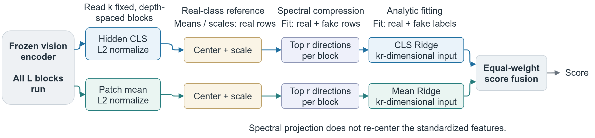

# Lightning_AGI_Detector

Lightning detects image forgeries using intermediate features from multiple blocks of a frozen, pretrained vision backbone. It centers and scales these features using statistics from real source images, then compresses them spectrally to reduce the cost of gradient-free Ridge fitting.

With a shared, fixed feature mapping, workers can accumulate sufficient statistics on disjoint data partitions. Summing these statistics and solving centrally gives the same Ridge solution as fitting on the pooled data with the same regularization strength.

## Method Overview

```text
Input image
└── Frozen vision backbone
    └── Features from selected blocks
        ├── Global readout
        │   └── Block-wise spectral projection and concatenation → Ridge score
        └── Patch-mean readout
            └── Block-wise spectral projection and concatenation → Ridge score

Final detection score = mean of the two raw scores
```



## Environment

Run the commands from the repository root with [uv](https://docs.astral.sh/uv/) installed.

1. **Install dependencies.**

   ```bash
   uv sync --locked
   ```

2. **Create `.env`.**

   ```bash
   test -f .env || cp .env.example .env
   ```

3. **Set `FFPP_ROOT` in `.env` to your local FaceForensics++ directory.**

   ```dotenv
   FFPP_ROOT="${HOME}/datasets/DeepfakeDataset/FaceForensics++"
   ```

   The [bundled manifests](configs/manifests/) expect extracted frames under `FFPP_ROOT`, such as `original_sequences/youtube/c23/frames/001/000.png`.

Lightning downloads the default `openai/clip-vit-large-patch14` backbone weights from Hugging Face if they are missing from the local cache. See [`detectors/lightning/config.py`](detectors/lightning/config.py) for the backbone setting.

## Training

Fit Lightning on the FaceForensics++ training split and score it on the validation split. The bundled manifests sample 8 frames per training video and 32 per validation or test video.

```bash
FIT_DIR=$(uv run python engine.py fit --model lightning \
  --train-input ffpp_train \
  --validation-input ffpp_val \
  --device auto)
```

`--device auto` uses an available PyTorch accelerator and falls back to CPU. Use `--device cuda:0` or `--device cpu` to select a device explicitly.

The fitted checkpoint is saved at `$FIT_DIR/fit/model.pth`. To continue fitting on new images, pass this file to `fit` with `--checkpoint` and select the new training input with `--train-input`. Lightning reuses the saved feature mapping and updates the Ridge statistics.

## Evaluation

Evaluate the checkpoint from the training example on the FaceForensics++ test split.

```bash
uv run python engine.py evaluate --model lightning \
  --checkpoint "$FIT_DIR/fit/model.pth" \
  --test-inputs ffpp_test \
  --device auto
```

For an existing fit, replace the checkpoint argument with the path to its `model.pth`. `--test-inputs` accepts one or more input names from [`configs/config.yaml`](configs/config.yaml). The evaluation prints its run directory, which contains `summary.csv` and a `metrics.json` and `predictions.jsonl` for each input.

## Multi-GPU

On a single host with two visible GPUs, use `torchrun` to launch one process per GPU. Each process reads a disjoint shard of the input, with `batch_size` applied per process. Rank 0 combines the statistics, solves the Ridge readout, and saves one checkpoint.

```bash
uv run torchrun --standalone --nproc-per-node=2 engine.py fit --model lightning \
  --train-input ffpp_train \
  --validation-input ffpp_val \
  --device cuda
```

Use `fit/model.pth` from the run directory printed by `fit`. To continue fitting, pass it to `fit` with `--checkpoint` and select a new `--train-input`. Evaluation collects predictions from all ranks before computing metrics, including video-level scores.

```bash
uv run torchrun --standalone --nproc-per-node=2 engine.py evaluate --model lightning \
  --checkpoint outputs/your-fit-run/fit/model.pth \
  --test-inputs ffpp_test \
  --device cuda
```
